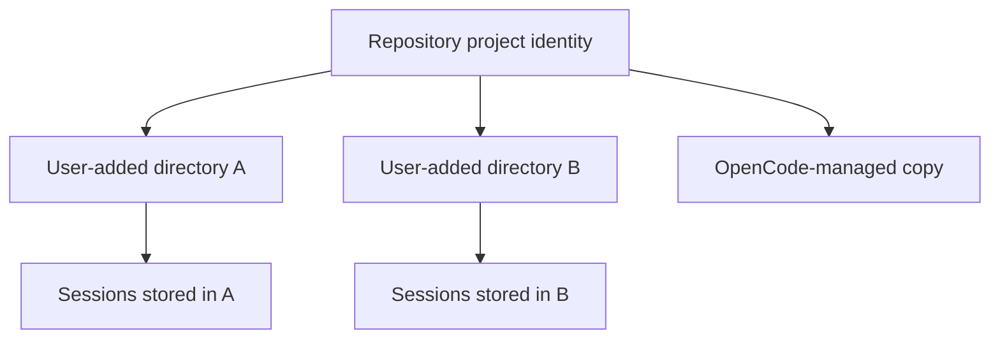
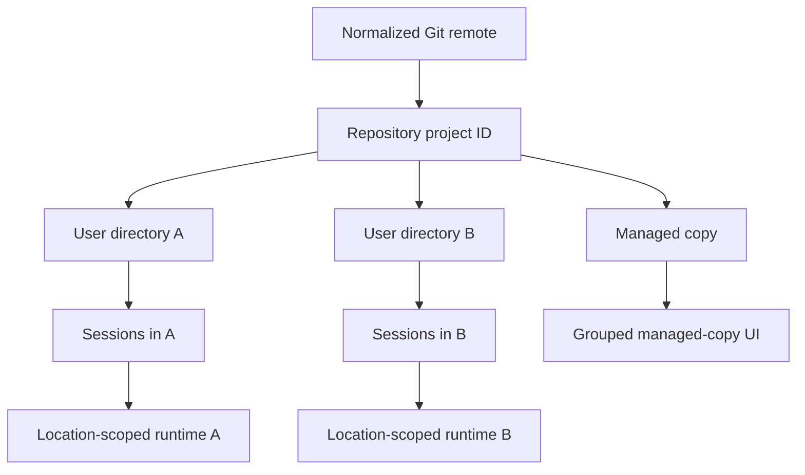
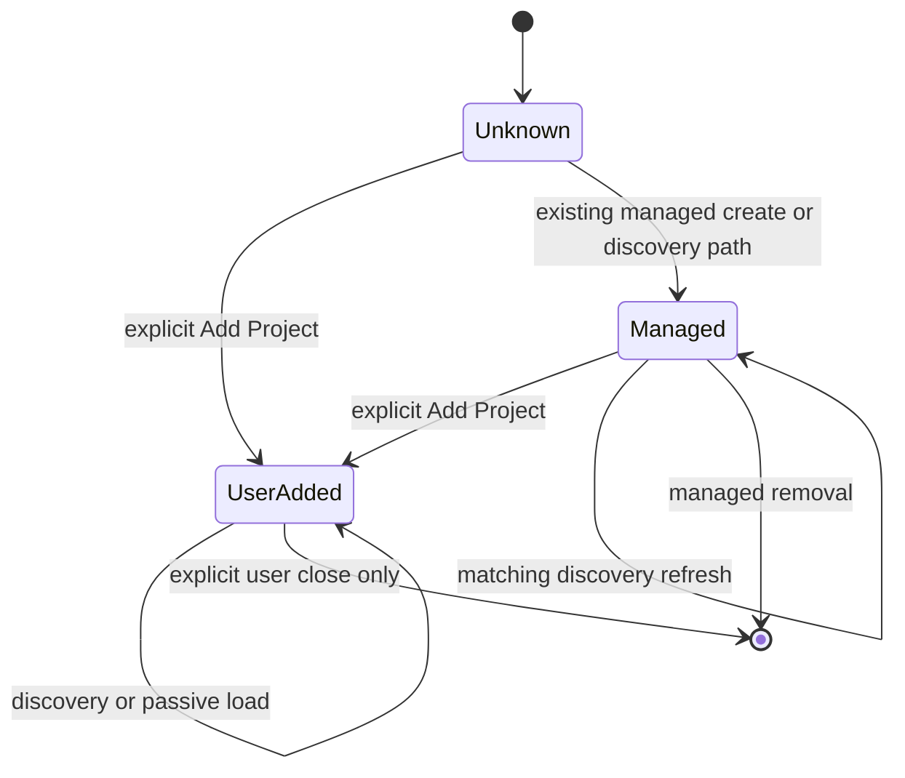
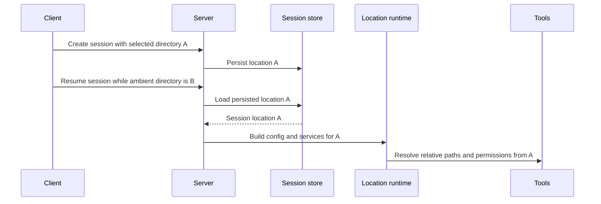

# Directory-Scoped OpenCode Projects - Plan

## Goal Capsule

- **Objective:** Allow multiple user-added checkout directories for one Git repository to remain independently selectable, session-scoped, and permission-scoped across OpenCode clients.
- **Product authority:** This plan defines the user-visible boundary between repository identity and an active project directory while preserving repository-level compatibility for explicit session movement.
- **Open blockers:** None before planning.
- **Execution profile:** Implement the directory-classification authority first, then update client presentation, session routing, and permission containment against that authority.
- **Stop conditions:** Stop if implementation requires changing repository project identity, cannot distinguish explicit user registration from passive instance loading, or would broaden managed removal beyond the current strategy-marked Git worktree model.
- **Tail ownership:** The implementing run owns generated client updates, focused cross-package tests, package typechecks, and removal of abandoned approaches before closeout.

---

## Product Contract

### Summary

OpenCode will preserve one repository-level project identity while treating each user-added directory as a distinct project location, session-history scope, execution context, and permission boundary.
Selecting a directory will determine which sessions are visible and where those sessions execute without implicitly granting access to sibling checkouts of the same repository.

### Problem Frame

OpenCode currently assigns separate clones of the same Git remote one project identity and treats alternate directories as copies of a canonical worktree.
Clients can consequently replace a directory selected through Add Project with an earlier checkout, making sessions and work appear to belong to the wrong directory.
Repository identity remains useful for compatibility, but it cannot safely substitute for the concrete directory in which a user chose to work.

### Key Decisions

- **Keep repository identity remote-derived.** (session-settled: user-approved — chosen over directory-specific project IDs: repository compatibility remains useful for explicit session movement and does not need a foreign-key migration.)
- **Keep user-added directories independently selectable.** (session-settled: user-directed — chosen over grouping every same-remote checkout: an explicit Add Project selection represents an independent working context.)
- **Scope session history to the selected directory.** (session-settled: user-directed — chosen over repository-wide history: switching or moving sessions between working contexts should be explicit.)
- **Use the selected directory as the OpenCode permission boundary.** (session-settled: user-directed — chosen over repository-wide access and hard filesystem isolation: sibling checkouts use normal `external_directory` permission handling, while shell authority retains its documented limitations.)
- **Retain grouping for OpenCode-managed copies.** (session-settled: user-approved — chosen over presenting every managed worktree as a top-level project: managed copies remain part of their source project's workflow.)
- **Apply the behavior across OpenCode clients.** (session-settled: user-directed — chosen over a desktop-only correction: directory identity must not depend on which supported client initiated the session.)

### Identity And Location Model

Repository identity establishes compatibility between locations.
The selected directory establishes presentation, execution, configuration, and permission context.

### Requirements

**Directory selection and presentation**

- R1. Every directory explicitly added by a user must remain independently selectable even when another added directory resolves to the same repository identity.
- R2. Selecting or opening a user-added directory must not silently redirect, replace, or normalize it to another checkout of the same repository.
- R3. OpenCode-managed copies may remain grouped with their source project and must not be mistaken for independently user-added directories.
- R4. Supported clients must preserve the same directory-selection semantics while retaining their native navigation and presentation patterns.

**Session ownership and execution**

- R5. A session created from a selected directory must store that directory as its execution location.
- R6. A directory's default session history must include only sessions assigned to that directory, even when sibling directories share its repository identity.
- R7. Continuing an existing session must use the session's stored directory rather than another currently selected or canonical directory.
- R8. Relative paths, project configuration, instructions, provider context, and tools used by a session must resolve from the session's directory.
- R9. Moving a session between directories must remain an explicit operation and may use the shared repository identity as its compatibility check.
- R10. After a successful session move, subsequent visibility and execution must use the destination directory.

**Permission boundary**

- R11. The session's directory must be the internal location for normal OpenCode path-permission evaluation.
- R12. A sibling checkout must be treated as external to the active session even when both directories share one repository identity.
- R13. Repository association alone must never grant a session access to files in another checkout.
- R14. Access from one checkout to another must follow normal `external_directory` permission evaluation, including any explicit user or configuration grants.

### Actors

- A1. **User:** Adds directories, chooses a working context, creates or resumes sessions, and explicitly approves external-directory access or session movement.
- A2. **OpenCode client:** Presents selectable directories and directory-scoped session history without collapsing independent checkouts.
- A3. **OpenCode server:** Routes session operations, configuration, tools, and permissions through the session's concrete directory while retaining repository compatibility identity.

### Key Flows

- F1. Add same-remote directories
  - **Trigger:** A1 adds directory A and directory B, which resolve to the same Git remote.
  - **Actors:** A1, A2, A3.
  - **Steps:** A3 associates both directories with the shared repository identity; A2 retains A and B as separate user-added locations.
  - **Outcome:** A1 can select either directory without being redirected to the other.
  - **Covered by:** R1-R4.
- F2. Create and continue a directory-scoped session
  - **Trigger:** A1 selects directory A and starts or resumes a session.
  - **Actors:** A1, A2, A3.
  - **Steps:** A2 requests the session in A; A3 stores or reads A as the session location and runs all location-scoped behavior from A.
  - **Outcome:** The session appears only under A by default and performs work from A.
  - **Covered by:** R5-R8.
- F3. Access a sibling checkout
  - **Trigger:** A session in directory A attempts to access directory B.
  - **Actors:** A1, A3.
  - **Steps:** A3 recognizes B as external to A and applies normal external-directory permission evaluation.
  - **Outcome:** The shared repository identity does not bypass the permission decision.
  - **Covered by:** R11-R14.
- F4. Move a session between compatible directories
  - **Trigger:** A1 explicitly moves a session from A to B.
  - **Actors:** A1, A2, A3.
  - **Steps:** A3 verifies repository compatibility, performs the move, and records B as the new session location; A2 updates directory-scoped history.
  - **Outcome:** The moved session is subsequently visible and executable in B rather than A.
  - **Covered by:** R9-R10.

### Acceptance Examples

- AE1. **Covers R1-R4.** Given independently cloned directories A and B with the same normalized remote, when the user adds both, then every supported client that presents project locations keeps A and B independently selectable.
- AE2. **Covers R5-R8.** Given A is selected, when the user creates a session and asks it to inspect or edit a relative path, then the session is listed under A and resolves the path from A.
- AE3. **Covers R6-R7.** Given A and B each have sessions, when the user selects B or resumes a session stored in B, then only B's sessions are shown by default and the resumed session executes in B.
- AE4. **Covers R11-R14.** Given a session executing in A, when it targets a file in B, then B is evaluated as an external directory and the common repository identity supplies no implicit permission.
- AE5. **Covers R3.** Given OpenCode creates a managed copy from A, when clients refresh project locations, then the managed copy may remain grouped with A and does not force B to collapse into A.
- AE6. **Covers R9-R10.** Given a session in A and a compatible directory B, when the user explicitly moves the session to B, then future history and execution use B.
- AE7. **Covers R1-R14.** Given the same server state is viewed through different supported clients, when a location is selected and a session runs, then each client routes the session to the same selected directory and applies the same permission boundary.

### Scope Boundaries

- Do not replace the repository-level project ID with a composite repository-and-directory ID.
- Do not migrate project, session, workspace, or permission foreign keys solely to distinguish checkout directories.
- Do not add repository-wide session history or automatic session synchronization between OpenCode servers.
- Do not introduce OS-enforced filesystem isolation; this work uses OpenCode's normal permission model and preserves documented shell-authority limitations.
- Do not redesign each client's navigation beyond what is necessary to retain and select independent user-added directories.

### Dependencies And Assumptions

- Repository identity remains the authority for deciding whether two locations are compatible for explicit session movement.
- Directory classification must reliably distinguish user-added locations from OpenCode-managed copies.
- Session routing must continue to prefer a session's persisted location over ambient client selection.
- Explicit permission configuration may grant external-directory access; the requirement is to prevent implicit access based only on repository association.

### Outstanding Questions

**Resolved in Planning**

- Directory records will expose user/managed classification, the existing strategy, and optional exact source metadata without adding a filesystem ownership identity.
- Legacy strategy-marked and strategy-free rows will preserve their current managed and ordinary behavior; missing source metadata uses the existing grouping fallback.
- The Verification Contract combines focused Core, server, app, TUI, ACP, permission, and concurrent-location scenarios to demonstrate consistent routing and containment.

### Sources And Research

- `packages/core/src/project.ts` defines remote-derived repository identity.
- `packages/core/src/project/directories.ts` tracks directories and managed-copy strategy under one project identity.
- `packages/opencode/src/project/project.ts` currently records alternate directories as sandboxes.
- `packages/app/src/context/layout.tsx` currently normalizes sandbox entries to a stored worktree.
- `packages/core/src/session.ts` and `packages/opencode/src/session/session.ts` retain and filter session directories.
- `packages/core/src/control-plane/move-session.ts` validates repository compatibility for explicit session movement.
- `packages/opencode/src/project/instance-store.ts` keys runtime instances by resolved directory.
- `packages/opencode/src/server/routes/instance/httpapi/middleware/workspace-routing.ts` routes session requests through the persisted session directory.
- `packages/core/src/location-mutation.ts` and `packages/opencode/src/tool/external-directory.ts` enforce the active location boundary for file operations.
- `packages/tui/src/context/project.tsx` and `packages/tui/src/component/dialog-move-session.tsx` already consume project-directory records and managed-copy strategy.

---

## Planning Contract

### Product Contract Preservation

Product Contract unchanged.
The implementation design below preserves every R, A, F, and AE identifier and does not broaden the confirmed move-session or filesystem-isolation scope.

### Key Technical Decisions

- **Repository identity and location remain separate authorities.** (session-settled: user-approved — chosen over directory-specific project IDs: repository identity remains the compatibility key while the persisted directory controls presentation and execution.)
- **Explicit user registration is a distinct operation.** (session-settled: user-approved — chosen over passive instance-load classification: Add Project must record user intent without allowing routine bootstrap or resume to demote managed copies.)
- **Directory classification records intent and source without redefining filesystem trust.** A row records whether it is user-selected or managed plus the existing copy strategy and optional exact source directory. Explicit Add Project changes the row to user-selected; managed creation and discovery retain the current Git-worktree model.
- **Filesystem behavior stays at OpenCode parity.** Classification and removal use the existing resolved paths, Git worktree topology, strategy operations, and SQLite behavior. This change adds no file-owner, mode, ACL, capability, inode/device, xattr, mount-type, or symlink-support requirement.
- **Legacy rows preserve existing behavior.** Strategy-marked rows remain managed; strategy-free rows remain ordinary directories; missing source metadata uses the current project grouping. Only managed creation can establish an exact source; refresh never invents one.
- **Clients derive navigation from directory records.** (session-settled: user-directed — chosen over project-ID de-duplication: top-level entries are keyed by normalized directory and share repository metadata without sharing session scope.)
- **Legacy `sandboxes` remains compatibility data only.** Updated clients must not use the undifferentiated array as authority for classification, top-level de-duplication, history filtering, or removal rights.
- **Persisted session location wins after creation.** (session-settled: user-directed — chosen over ambient client or process directories: create uses the selected request location and every resume path reconstructs context from the stored session location.)
- **Permission checks use directory-only containment.** (session-settled: user-directed — chosen over repository-wide containment and OS sandboxing: permission-sensitive tools treat sibling paths as external while unrelated worktree-aware services may retain broader repository context.)
- **Saved permission approvals use persisted session location identity.** (session-settled: user-directed — chosen over repository-wide new grants: new `always` approvals are keyed by the session's persisted `Location.directory`, project, action, and resource without additional filesystem canonicalization; legacy project-scoped approvals retain their current behavior.)
- **Existing move capability is preserved without a new client feature.** (session-settled: user-approved — chosen over adding move controls to every client: supported move paths remain repository-compatible and subsequent execution follows the destination.)

### High-Level Technical Design

**Authority separation**

The repository project ID supplies shared metadata and move compatibility.
Each directory record supplies presentation classification and, when creation recorded it, a managed copy's exact source parent. Each session's persisted location supplies runtime and permission context.

**Directory classification transitions**

Explicit user intent may demote a managed classification, but discovery and passive instance loading may never promote or remove a user-added row.
Managed removal retains the current authority model: a managed classification, stored strategy, and that strategy's normal Git worktree validation. Exact source metadata improves grouping and refresh decisions but does not introduce an ownership file or stronger host-filesystem proof.

**Session location authority**

Before a session exists, explicit payload and transport locations must agree when both are supplied, and either one may supply the selected location alone. Existing locationless callers retain their current server-default compatibility behavior in this change; supported clients are updated to send an explicit location, and removal of the compatibility fallback requires separate Product Contract approval.
After creation, the persisted session location overrides ambient request, client, ACP, and process directories.

### Implementation Constraints

- Preserve runtime dependency direction from Schema to Core and Protocol, then Core and Protocol to Server; clients consume generated or public interfaces rather than importing server implementation.
- Keep `Project.Info.sandboxes` and existing project IDs stable for compatibility, but remove their authority from changed client decisions.
- Keep passive project instance creation idempotent and classification-neutral.
- Add only directory classification/source fields, a nullable saved-permission directory, and the user-intent operation; do not add a second project identity or a new persistence table.
- Serialize registration and removal with the existing process-local keyed-mutex pattern and ordinary SQLite transactions. Do not add a filesystem lock or claim distributed locking across hosts or independently running OpenCode versions.
- Preserve the existing test and runtime filesystem contract: normal readable/writable temporary directories, `realpath` where current code already uses it, Git worktree commands, and SQLite semantics. Unsupported operations fail through existing Git/filesystem errors rather than new capability probes.
- Treat directory-update events as invalidation hints; operation responses and refetched directory state remain authoritative.
- Regenerate public client artifacts through repository scripts when the project-directory operation changes the exposed HTTP API.
- Keep shell argument-path detection advisory as documented; enforce the location boundary where OpenCode's path and workdir permission checks are authoritative.

### Sequencing

1. Establish safe directory-classification transitions and explicit user registration.
2. Consume authoritative classification in clients and remove unsafe `sandboxes` de-duplication and deletion behavior.
3. Make session listing, creation, and resume consistently location-authoritative.
4. Align permission-sensitive containment with the active session directory.
5. Close with cross-client and concurrent-location integration coverage.

### System-Wide Impact

- **Users:** Same-remote clones remain visible and cannot be silently redirected or treated as deletable managed copies.
- **Agents:** Configuration, instructions, tools, MCP state, relative paths, and permissions reconstruct from the session's persisted location.
- **Clients:** App/desktop and TUI retain native navigation but share exact-directory selection and history semantics; API and ACP callers receive the same location authority.
- **Persistence:** Existing project and session identifiers remain stable; migrations add directory classification/source metadata and a nullable persisted-directory identity to saved permissions while preserving legacy rows.
- **Generated interfaces:** Additive source-parent output and user-registration operations require regenerated legacy SDK artifacts but no project-ID or session foreign-key migration.

### Risks And Mitigations

- **Classification changes could accidentally tighten filesystem support.** Reuse existing Git and path services; do not inspect ownership, permissions, capabilities, inode identity, mount type, or symlink support, and do not add NFS/SMB-specific guarantees or tests.
- **Passive boot could erase managed classification.** Keep explicit user registration separate from `fromDirectory` and instance loading.
- **Registration could race managed removal.** Serialize both operations per resolved directory within the server process and make database transitions atomic; keep cross-host and mixed-version coordination outside this change.
- **Project-ID reconciliation could drop directory or permission state.** Re-key and conservatively merge all rows instead of clearing them, preserving legacy semantics on collisions.
- **Discovery could race Add Project.** Put transitions in the Core directory service and make them atomic rather than coordinating read-then-write state in clients.
- **Lost or reordered invalidation events could leave clients stale.** Refetch after local registration, matching invalidations, and reconnect, with latest-response-wins protection.
- **Client paths could retain repository-wide history.** Test exact-directory listing independently in app and TUI, including checkout-root queries.
- **Ambient cwd or cached ACP state could leak into resumed context.** Test HTTP and ACP resume and cross-client moves with a conflicting caller directory and assert persisted-location configuration, MCP state, permissions, and tools.
- **Permission changes could regress repository-aware services.** Introduce permission-specific directory containment instead of globally narrowing every worktree consumer.
- **New saved permissions could bleed between locations.** Test that a new approval established in A for external target C does not satisfy the same action/resource from B; preserve legacy project-scoped rows rather than silently changing existing grants.
- **Concurrent sessions could share location-scoped state.** Exercise simultaneous A/B sessions with distinct configuration, markers, and tool effects.

### Failure Boundaries

| Operation                 | Durable authority point                                                                                      | Fail-safe outcome                                                                                                                        |
| ------------------------- | ------------------------------------------------------------------------------------------------------------ | ---------------------------------------------------------------------------------------------------------------------------------------- |
| User registration         | Classification changes to user-selected and clears managed strategy/source under process-local serialization | A failed response may be retried; every successful or idempotent response returns authoritative state and prompts client refetch         |
| Managed creation          | Existing strategy creation succeeds and strategy/source classification is persisted                          | Existing Git/filesystem errors are preserved; database failure follows the current compensation/error style without new ownership checks |
| Managed removal           | Stored managed strategy is checked and the existing strategy removal runs under process-local serialization  | Failed or dirty-worktree removal preserves the row and filesystem exactly as current ProjectCopy tests require                           |
| Project-ID reconciliation | All project-owned directory, session, workspace, and saved-permission rows are atomically re-keyed or merged | Existing rows and compatibility semantics survive; no row is silently cascaded away                                                      |
| Saved permission          | New rows persist the session's established `Location.directory`; legacy rows retain a null directory         | New A grants apply only in A; legacy project-scoped grants continue to behave as before                                                  |
| Client invalidation       | Authoritative operation response or completed refetch is applied                                             | Missed, duplicate, or reordered events trigger no classification mutation and cannot overwrite newer fetched state                       |

### Deferred To Follow-Up Work

- Removing `Project.Info.sandboxes` from public compatibility surfaces.
- Adding session-move controls to clients that do not currently expose them.
- Removing locationless session-creation compatibility and the server-default fallback.
- Hard filesystem sandboxing for shell processes.

---

## Implementation Units

### U1. Make Directory Classification Authoritative

**Goal:** Define atomic user-registration, managed-creation, and managed-discovery transitions without changing project identity.

**Requirements:** R1-R3, R13-R14; F1; AE1, AE5; directory-classification and filesystem-parity KTDs.

**Dependencies:** None.

**Files:**

- Modify `packages/core/src/project/sql.ts`.
- Modify `packages/core/src/project/directories.ts`.
- Modify `packages/core/src/project/copy.ts`.
- Add a timestamped migration under `packages/core/src/database/migration/` for directory classification and optional managed source.
- Regenerate `packages/core/schema.json`, `packages/core/src/database/schema.gen.ts`, and `packages/core/src/database/migration.gen.ts` through the repository migration workflow.
- Modify `packages/opencode/src/project/project.ts` for project-ID reconciliation.
- Modify `packages/core/test/project-directories.test.ts`.
- Modify `packages/core/test/project-copy.test.ts`.
- Modify `packages/core/test/database-migration.test.ts` for legacy-row migration coverage.
- Modify `packages/opencode/test/project/project-directory.test.ts`.

**Approach:** Extend the directory table and service with intent-specific transitions instead of a generic replace flag at call sites.
Store `kind = user | managed` and optional `source_directory` beside the existing strategy. User registration records `kind = user` and clears strategy/source; managed creation records `kind = managed`, strategy, and exact source. Discovery preserves a known source but leaves it null for external or legacy rows because Git topology does not identify the creator.
Migrate strategy-marked rows to `managed` and strategy-free rows to `user` without reclassifying or deleting either. Legacy managed rows keep a null source and use current project grouping; only newly managed creation records an exact source.
Removal continues to require a managed strategy and runs that strategy's existing validation/removal operation. It does not add marker files, file-ownership checks, inode/device identity, mode/ACL/capability checks, or new symlink behavior.
Serialize registration, discovery transitions, and removal with Core's process-local `KeyedMutex` pattern plus ordinary database transactions. This prevents in-process read/modify races without introducing a filesystem lock or a distributed-filesystem claim.
Replace project-ID migration's clear-and-repopulate behavior with an atomic audit and re-key of current project foreign keys: directories, sessions, workspaces, and saved permissions. On directory collisions, explicit `user` classification wins; otherwise preserve existing strategy/source data without inventing filesystem evidence.
Passive directory resolution may insert a missing ordinary `user` row with current insert-ignore semantics, but it never updates or clears an existing managed row. Only explicit registration demotes managed to user.

**Patterns to follow:** Effect service methods in `packages/core/src/project/directories.ts`, transaction-bound updates in `packages/core/src/project/copy.ts`, and existing table keys in `packages/core/src/project/sql.ts`.

**Execution note:** Start with characterization coverage for current managed create, refresh, and remove behavior, then add failing transition tests before changing classification logic.

**Test scenarios:**

- Covers AE1. Register independent clone A and same-remote clone B; both rows remain `user` under one project ID.
- Covers AE5. Create and remove a managed copy using the same real temporary Git repository and `git worktree` operations as existing ProjectCopy tests.
- Create managed copies from A and B; each stores its exact source and groups only under that source.
- Register a managed directory explicitly; registration clears strategy/source and managed removal rejects it.
- Discover an externally created Git worktree; its classification and removal behavior remain consistent with the current discovery tests until explicit registration changes it to user-selected.
- Refresh managed rows; normal Git topology preserves an already known source and leaves unknown legacy or externally discovered source metadata null.
- Replace a managed path with a non-worktree directory; the existing strategy operation fails and preserves the replacement without requiring inode or device identity.
- Migrate legacy strategy-marked and strategy-free rows; both preserve their current managed/ordinary behavior.
- Refresh a missing ordinary directory; preserve the current row-pruning behavior and assert no filesystem deletion is attempted.
- Race user registration against discovery; the committed result is `user` and cannot be deleted as managed.
- Order registration and removal deterministically with `Deferred` or another in-process latch rather than sleeps; registration-first prevents managed removal, while successful removal-first leaves no directory to register.
- Preserve current dirty-worktree and strategy-error behavior: failed removal leaves both the row and filesystem intact.
- Reconcile a root-derived project ID to a remote-derived ID with A, B, managed rows, saved permissions, and collisions; all rows survive without cascade loss and `user` wins ambiguous directory classification.

**Verification:** Focused service/database tests, real temporary Git worktree tests, and `bun run migration --check` demonstrate the transitions without adding host ownership, capability, inode, mount, or symlink requirements.

### U2. Expose Explicit User Directory Registration

**Goal:** Give Add Project a user-intent operation without coupling ownership changes to instance boot or session resume.

**Requirements:** R1-R4; F1; AE1, AE5; explicit-registration KTD.

**Dependencies:** U1.

**Files:**

- Modify `packages/opencode/src/server/routes/instance/httpapi/groups/project.ts`.
- Modify `packages/opencode/src/server/routes/instance/httpapi/handlers/project.ts`.
- Modify `packages/opencode/src/server/routes/instance/httpapi/middleware/workspace-routing.ts` to expose whether location authority was explicit or workspace-controlled.
- Modify `packages/opencode/src/project/project.ts` only where needed to delegate explicit registration while leaving `fromDirectory` classification-neutral.
- Modify `packages/opencode/test/project/project-directory.test.ts`.
- Modify `packages/opencode/test/server/project-copy.test.ts`.
- Modify `packages/opencode/test/server/httpapi-exercise/index.ts`.
- Modify `packages/app/src/context/server-sync.tsx` where project-directory invalidations trigger refetch.
- Modify `packages/tui/src/context/project.tsx` where directory state refreshes after registration, invalidation, or reconnect.
- Regenerate affected files under `packages/sdk/js/src/v2/gen/` and `packages/sdk/openapi.json` through root `bun run script/generate.ts`.

**Approach:** Add an idempotent `POST /project/directories/current` operation with no project or directory payload. A route-specific precondition requires an explicit directory query/header or a server-controlled workspace target before instance loading, then the existing workspace-routing and instance-context middleware establish the canonical directory and resolved project used by U1's user-registration transition.
Do not overload project discovery, current-project lookup, or `InstanceStore.load` with user intent.
The operation can mutate only that existing request-scoped directory; aliases canonicalize before lookup, and no second host path or caller-supplied project identity exists to create a mismatch. It follows the server's configured authorization posture rather than claiming authentication when the server is intentionally configured without credentials.
Return authoritative directory state and publish the existing directory-update signal as an invalidation hint; clients refetch after local success, matching events, and reconnect, and prevent older fetches from overwriting newer state.

**Patterns to follow:** Existing typed project HTTP groups and handlers, project-directory list endpoint behavior, generated SDK workflow, and project-copy authorization boundaries.

**Test scenarios:**

- Covers F1 / AE1. Register A and B through the API; both remain listed as user directories under one project ID.
- Register the same directory repeatedly; state and event behavior remain idempotent.
- Register a strategy-marked directory; it becomes user-added and managed removal is denied.
- Load or resume a session in a managed copy without registration; classification remains managed.
- Request registration without explicit directory/workspace authority, or with an unresolved, nonexistent, or non-directory request location; it fails before instance loading without changing rows or publishing an update.
- Attempt to nominate another directory outside the request location; the endpoint has no path input and cannot perform the mutation.
- Register through the same resolved request-location forms already covered by project-directory routing tests; do not add a new symlink-capability fixture for this endpoint.
- Drop, duplicate, or reorder invalidation events and directory fetches; app and TUI converge from authoritative state and older responses never restore stale classification.
- Retry after a committed registration whose event publication failed; the response remains idempotent and restores client invalidation without repeating ownership changes.

**Verification:** HTTP exercise coverage, generated SDK output, and project-directory tests prove that explicit user action is the only demotion path.

### U3. Build Directory-Keyed App Project Presentation

**Goal:** Keep user-added A/B entries independent in the shared app/desktop UI while grouping only authoritative managed copies.

**Requirements:** R1-R4, R6; A1-A2; F1-F2; AE1, AE3, AE5; client-directory and compatibility-data KTDs.

**Dependencies:** U2.

**Files:**

- Modify `packages/app/src/context/layout.tsx`.
- Modify `packages/app/src/context/global.tsx`.
- Modify `packages/app/src/pages/layout.tsx`.
- Modify `packages/app/src/pages/home/home-controller.ts`.
- Modify `packages/app/src/pages/home/home-projects-controller.tsx`.
- Modify `packages/app/src/utils/server-compat.ts`.
- Modify `packages/app/src/context/layout.test.ts`.
- Modify `packages/app/src/context/server.test.ts`.
- Modify `packages/app/src/utils/server-compat.test.ts`.
- Add focused coverage in `packages/app/src/pages/home/home-sessions-controller.test.tsx`.
- Add `packages/app/e2e/regression/directory-scoped-projects.spec.ts` for the two same-remote-directory flow.

**Approach:** Derive top-level and managed-child entries from project-directory records, keyed by normalized directory and enriched with shared project metadata.
Call U2's registration operation only from live Add Project intent; passive restoration of persisted client entries must not demote a strategy-marked managed copy.
Replace `sandboxes`-driven root normalization, current-project fallback, workspace grouping, and removal eligibility with the derived classification.
Group a managed child beneath its persisted source directory when present. Legacy managed rows without source metadata retain the current project-worktree grouping fallback rather than triggering new filesystem inference.
Persist pending explicit registration intent by normalized directory until an authoritative response/refetch confirms it. Startup remains classification-neutral except for replaying that bounded pending intent idempotently; ordinary restored entries never register themselves.
Keep unresolved or failed persisted paths visible in place rather than redirecting or dropping them. Loading entries remain selectable but expose no managed action; failed explicit registration retains a retry that replays its pending intent; ordinary load errors retry only loading.

**Patterns to follow:** Directory-keyed persisted server project state in `packages/app/src/context/server.tsx`, `pathKey` normalization, server compatibility adapters, and existing layout controller tests.

**Execution note:** Extract pure directory-classification and session-selection decisions where that enables deterministic unit coverage before changing rendered navigation.
Before changing app session-loading code, record the production benchmark baseline required by `packages/app/AGENTS.md` under `/tmp/opencode-mkchad/directory-scoped-projects/app-benchmark`, then rerun the same benchmark after the change and compare results for regressions.

**Test scenarios:**

- Covers AE1. Add A then B with one project ID; both top-level entries remain visible, selectable, ordered, and restorable after reload.
- Covers AE3. Selecting B resolves current-project state to B rather than the shared project's canonical worktree.
- Covers AE5. A strategy-marked copy appears under the repository grouping while B remains top-level.
- A pending directory-classification response does not remove or redirect a persisted top-level path.
- A failed directory-classification response retains the selected path and cannot expose a managed-delete action.
- Lose a committed Add Project response and reload; the persisted pending intent replays idempotently until authoritative state confirms registration, while an ordinary restored directory remains classification-neutral.
- Restore persisted state containing a strategy-marked managed copy; startup does not register or demote it.
- Managed copies created from A and B render beneath their exact respective source even when both sources share one project ID.
- A legacy managed row without source metadata preserves the current project-worktree grouping and removal behavior; no new filesystem inspection is used to infer its source.
- A user-added directory never exposes managed-delete actions; a strategy-proven managed copy does.
- An externally discovered worktree preserves the current strategy-based presentation and removal behavior until explicit Add Project intent reclassifies it.
- Closing B removes only the client entry and does not mutate A or repository metadata.

**Verification:** App unit and regression tests prove stable top-level identity, conservative loading, safe removal eligibility, and shared desktop/web behavior.

### U4. Scope App And TUI Session History To Exact Directory

**Goal:** Ensure selecting A or B shows only sessions assigned to that exact directory in every existing session-list path.

**Requirements:** R4-R7, R10; F2, F4; AE2, AE3, AE6, AE7; directory-local history KTD.

**Dependencies:** U3.

**Files:**

- Modify `packages/app/src/pages/home/home-sessions-controller.tsx`.
- Modify `packages/app/src/pages/layout.tsx`.
- Modify `packages/app/src/pages/layout/helpers.ts`.
- Modify `packages/app/src/context/global-sync/session-load.ts` only if query construction needs consolidation.
- Modify `packages/tui/src/context/sync.tsx`.
- Modify `packages/tui/src/context/project.tsx`.
- Modify `packages/tui/src/component/dialog-move-session.tsx`.
- Modify `packages/app/src/pages/home/home-sessions-controller.test.tsx`.
- Modify `packages/app/src/pages/layout/helpers.test.ts`.
- Modify `packages/tui/test/component/dialog-session-list.test.ts`.
- Add `packages/tui/test/component/dialog-move-session.test.tsx` for move-dialog directory-state coverage.
- Modify `packages/tui/test/cli/cmd/tui/sync.test.tsx`.
- Modify `packages/opencode/test/server/session-list.test.ts`.

**Approach:** Prefer exact session directory over repository ID in project lookup, navigation, and history filtering.
App selection loads one top-level directory unless the user is explicitly navigating a managed child.
The TUI treats its active instance directory as the selected location instead of deriving a `mainDir` from whichever strategy-free project row sorts last. Directory records supply exact move destinations and source-specific managed labels, not an implicit replacement for the active directory.
TUI checkout-root history sends an exact absolute-directory condition instead of an empty relative path that broadens to project scope.
Preserve explicit project-wide modes where they already exist, but never use them as the default directory view.

**Patterns to follow:** Existing directory-filtered session APIs, app `pathKey` comparison, and TUI explicit project-scope query handling.

**Test scenarios:**

- Covers AE3. A and B each contain sessions under one project ID; selecting either lists only its exact sessions.
- At repository root, TUI emits an exact-directory query and does not broaden through an empty path.
- Launch the TUI in B while A shares its project ID; B remains the selected directory regardless of directory-row ordering or refresh timing.
- In the move dialog, loading and failed directory state cannot redirect selection; managed destinations use source metadata when available and current fallback labeling otherwise, and selecting B moves only to exact B.
- A session lookup prefers exact directory B even when project metadata's stored worktree is A.
- Managed copy selection lists that copy's sessions without merging source-root history.
- Covers AE6. After a move event changes A to B, reducers remove the session from A's list and expose it under B.
- Explicit project-wide history remains available only through its existing opt-in mode.

**Verification:** Focused app, TUI, and server tests demonstrate exact-directory history at root, nested, managed-copy, and moved-session states.

### U5. Make Session Creation And Resume Location-Authoritative

**Goal:** Make explicit session creation and every existing-session resume location-authoritative across HTTP, API/SDK, and ACP paths without breaking legacy locationless creation.

**Requirements:** R5, R7-R10; A2-A3; F2, F4; AE2, AE3, AE6, AE7; persisted-location KTD.

**Dependencies:** None.

**Files:**

- Modify `packages/protocol/src/groups/session.ts` and `packages/protocol/src/api.ts` to supply request-location middleware to session creation without changing the public payload shape.
- Modify `packages/server/src/location.ts` to expose optional explicit transport location separately from the resolved compatibility location.
- Modify `packages/server/src/handlers/session.ts`.
- Regenerate `packages/client/src/generated/` and `packages/client/src/generated-effect/` through `packages/client` scripts.
- Modify `packages/opencode/src/acp/service.ts`.
- Modify `packages/opencode/src/acp/session.ts` and `packages/opencode/src/acp/event.ts` if needed to invalidate and rebind loaded ACP sessions after external moves.
- Modify `packages/core/test/session-create.test.ts`.
- Modify `packages/opencode/test/server/httpapi-session.test.ts`.
- Modify `packages/opencode/test/acp/service-session.test.ts`.

**Approach:** Characterize all current HTTP, API/SDK, and ACP creation and resume call paths before changing them, then separate lightweight explicit-location capture from location-runtime loading. Compare payload and transport references using the existing `Location.Ref` and routing normalization without adding an independent `realpath`, symlink-resolution, or path-existence requirement: when both are present they must match in directory and workspace; when one is present it is authoritative; when neither is present, preserve the current locationless server-default compatibility path without presenting it as the selected-directory contract.
Update every supported client call path to send its selected location explicitly. Keep deprecation or removal of the locationless fallback out of this change.
For session resume, fetch the persisted session first and use its directory before loading configuration, models, commands, MCP state, snapshots, permission replies, or tool context.
Apply the same ordering to ACP load, resume, and any fork path that adopts an existing session location.
When another client moves an ACP-loaded session, invalidate source-location caches and rebind subsequent prompts to the new persisted location without requiring reconnect.

**Patterns to follow:** V2 session-location middleware, `LocationServiceMap` execution lookup, legacy session-ID routing that already prefers `session.directory`, and Core's explicit `Location.Ref` creation contract.

**Test scenarios:**

- Covers AE2. Create from request location A without a payload override; the session persists A rather than server cwd.
- Create with matching payload and transport location A; A is persisted exactly once.
- Create with payload location B while the transport location is A; reject the conflict without creating a session or loading either location's runtime.
- Characterize a legacy caller with neither explicit source; its existing server-default behavior remains compatible, while all supported clients prove they no longer rely on it.
- Covers AE3. Resume session A from ambient B; config, instructions, commands, models, MCP state, and tool runtime all use A.
- Load and fork an ACP session with conflicting caller cwd; persisted session location controls restored state.
- Covers AE6. Resume after an explicit move to B; all reconstructed location services use B.
- Load ACP session A, move it to B from another client, then prompt without reconnecting; B-only config, commands, MCP registration, permission routing, and tool metadata are used.
- Request an unknown session with a hostile caller cwd; fail before loading configuration or registering MCP state from that directory.

**Verification:** Session creation, HTTP routing, and ACP tests prove there is no process-cwd or caller-cwd path after a session location is known.

### U6. Narrow Permission-Sensitive Containment To Session Directory

**Goal:** Treat sibling checkout B as external to a session in A without narrowing unrelated repository-aware services.

**Requirements:** R8, R11-R14; A1, A3; F3; AE4, AE7; permission-boundary KTD.

**Dependencies:** U1, U5.

**Files:**

- Modify `packages/schema/src/permission-saved.ts`.
- Modify `packages/core/src/permission.ts`.
- Modify `packages/core/src/permission/sql.ts`.
- Modify `packages/core/src/permission/saved.ts`.
- Modify `packages/opencode/src/project/project.ts` to finalize directory-aware permission reconciliation.
- Modify `packages/opencode/src/project/instance-context.ts`.
- Modify `packages/opencode/src/tool/external-directory.ts`.
- Modify permission-sensitive shell path handling in `packages/opencode/src/tool/shell.ts` only where it uses worktree containment as authorization.
- Modify `packages/opencode/test/tool/external-directory.test.ts`.
- Modify `packages/opencode/test/tool/shell.test.ts`.
- Modify `packages/core/test/permission.test.ts` for saved-permission location coverage.
- Modify `packages/opencode/test/project/project-directory.test.ts` for directory-aware permission reconciliation.
- Add a timestamped Core migration for nullable saved-permission location identity and regenerate the Core migration artifacts listed in U1.

**Approach:** Introduce or use a directory-only containment predicate for permission-sensitive operations while retaining broader worktree containment for services that need repository context.
Relative paths in A remain internal; absolute paths and workdirs in B enter normal `external_directory` evaluation.
Do not infer grants from repository ID, project metadata, or managed-copy membership.
Add a permission-specific active-directory predicate rather than changing shared `containsPath`, which must retain its broader repository-worktree behavior for Config, LSP, and other existing consumers. Keep legacy shell/path parsing and Core `LocationMutation` on their current separate paths.
Persist the session's established `Location.directory` string on each new saved approval and include it in lookup and uniqueness with project, action, and resource. Do not independently call `realpath`, resolve symlinks, require the path to exist, or define grant sharing across aliases.
Keep the new directory column nullable. Existing rows with no directory retain current project-scoped behavior; new rows are location-scoped. Project-ID reconciliation merges location-specific rows only on identical persisted directory/action/resource keys and preserves legacy null-directory rows with their existing key.

**Patterns to follow:** Existing saved-permission service tests, direct internal/external path cases in legacy tool tests, Core `LocationMutation` tests unchanged, and the current shared `containsPath` consumers.

**Execution note:** Add failing same-remote A/B permission tests before changing containment so broader worktree consumers are not narrowed accidentally.

**Test scenarios:**

- Covers AE4. Read, write, or edit an ordinary direct relative path in A without external permission.
- Covers AE4. Target an ordinary direct absolute file in B from A; emit the expected `external_directory` request before file permission.
- Use B as the explicit shell workdir from A; require external-directory approval before shell permission without extending advisory command-argument discovery.
- Apply an explicit external-directory grant for B; access proceeds through normal permission evaluation.
- Use sibling directories with the same project ID; repository identity does not suppress the request.
- Let C be external to same-project locations A and B. Save an always-approval for C in A, then request the identical action/resource for C from B; B requires its own decision.
- Migrate a legacy project-only saved approval with null directory; it remains effective under its current project-scoped semantics.
- With an active nested directory, treat another direct path inside the repository worktree as external for permission-sensitive tools while existing Config/LSP repository containment remains unchanged.
- Run existing Core lexical-escape, escaping-symlink-ancestor, and in-location-symlink tests unchanged with their current platform guards. Add no symlink or alias assertions to legacy external-directory, shell, registration, or saved-permission tests.

**Verification:** Legacy and Core tests prove that direct sibling paths and authoritative shell workdirs use the active-directory boundary, new saved approvals use persisted session directory identity, legacy approvals and Core escape behavior remain compatible, and Config/LSP repository containment is unchanged.

### U7. Prove Cross-Client And Concurrent Location Isolation

**Goal:** Demonstrate that the complete A/B workflow remains directory-scoped across clients and concurrent agent execution.

**Requirements:** R1-R14; A1-A3; F1-F4; AE1-AE7.

**Dependencies:** U3, U4, U5, U6.

**Files:**

- Modify `packages/core/test/session-runner.test.ts`.
- Modify `packages/core/test/move-session.test.ts`.
- Modify `packages/opencode/test/server/httpapi-session.test.ts`.
- Modify `packages/app/e2e/regression/directory-scoped-projects.spec.ts` with the integrated session and permission assertions.
- Modify `packages/tui/test/cli/cmd/tui/sync-live-hydration.test.tsx` if live hydration needs explicit location coverage.

**Approach:** Build fixtures with same-remote A and B containing contradictory ordinary sentinel files, instructions, configuration, and tool-visible state.
Exercise independent session creation and concurrent turns, resume under conflicting ambient context, permission checks, managed-copy presentation, and the existing explicit move path.
Assert outcomes through durable session location, client-visible history, system context, and filesystem effects rather than implementation details.

**Test scenarios:**

- Covers AE1-AE3. Add A/B, create one session in each, and verify each client view selects and lists only its directory.
- Covers AE2, AE7. Prompt sessions in A and B concurrently; each reads its own sentinel, instructions, configuration, and relative files.
- Resume A while the client is on B; provider context and tool effects remain in A.
- Move an ACP-loaded A session to B from another client and continue without reconnecting; no cached A context survives.
- Covers AE4. Attempt A-to-B access during an agent turn; normal external-directory permission handling fires.
- Persist an approval in A for C, which is external to both A and B, while B runs concurrently; B cannot consume A's saved location-scoped approval.
- Covers AE5. Add a managed copy beside A/B; it remains grouped and is the only alternate directory eligible for managed removal.
- Covers AE6. Move an idle session from A to B; the next turn reconstructs B's context and history placement.
- Interrupt or fail one directory's turn; the other directory's runtime and permission state remain unaffected.

**Verification:** The integrated matrix proves context parity, client parity, permission isolation, move recovery, and independent concurrent execution under one repository project ID.

---

## Verification Contract

Use the Bun executable provisioned by the MkChad development environment and run tests from their owning package directories, never from the repository root.

### Filesystem Test Parity

- Extend `project-copy.test.ts` with the existing fixture style: normal temporary directories, real Git repositories, `git worktree add/remove`, database rows, and emitted events.
- Extend directory and migration tests through service calls and direct SQLite fixtures, not historical binaries, spawned competing migrators, filesystem locks, or network-filesystem simulations.
- Use ordinary direct A/B/C paths for new permission tests. Run current Core symlink/escape tests unchanged with their existing platform guards; do not add symlink requirements to legacy tool or registration tests.
- Do not add `chmod`, `chown`, UID/GID, ACL, Linux capability, xattr, inode/device, mount-type, lock-file, or filesystem-feature probes.
- Assert existing Git, SQLite, and filesystem error behavior rather than stronger crash durability, cache coherence, or distributed locking guarantees.

| Gate                           | Working directory    | Command                                                                                                                                                                        | Proves                                                                                    |
| ------------------------------ | -------------------- | ------------------------------------------------------------------------------------------------------------------------------------------------------------------------------ | ----------------------------------------------------------------------------------------- |
| Core classification            | `packages/core`      | `bun test test/project-directories.test.ts test/project-copy.test.ts test/database-migration.test.ts`                                                                          | U1 intent transitions, existing managed-copy lifecycle, and legacy-row migration          |
| Core migrations                | `packages/core`      | `bun run migration --check`                                                                                                                                                    | Directory and permission migrations, full schema, and migration registry are synchronized |
| Core location lifecycle        | `packages/core`      | `bun test test/session-create.test.ts test/session-runner.test.ts test/move-session.test.ts test/location-mutation.test.ts test/permission.test.ts`                            | U5-U7 persisted location, concurrency, move, containment, and saved-permission isolation  |
| OpenCode project/API           | `packages/opencode`  | `bun test test/project/project-directory.test.ts test/server/project-copy.test.ts test/server/session-list.test.ts`                                                            | U2 registration API and exact-directory server behavior                                   |
| OpenCode routing/ACP           | `packages/opencode`  | `bun test test/server/httpapi-session.test.ts test/acp/service-session.test.ts`                                                                                                | U5 resume and ambient-directory conflict handling                                         |
| OpenCode permissions           | `packages/opencode`  | `bun test test/tool/external-directory.test.ts test/tool/shell.test.ts`                                                                                                        | U6 sibling-checkout permission boundary                                                   |
| HTTP API completeness          | `packages/opencode`  | `bun test:httpapi`                                                                                                                                                             | New project-directory operation is exercised across required modes                        |
| Shared app unit tests          | `packages/app`       | `bun test:unit`                                                                                                                                                                | U3-U4 directory presentation and session filtering                                        |
| Shared app browser tests       | `packages/app`       | `bun test:browser`                                                                                                                                                             | Shared desktop/web interaction regressions                                                |
| Shared app E2E                 | `packages/app`       | `bun run test:e2e -- e2e/regression/directory-scoped-projects.spec.ts`                                                                                                         | The planned two-directory regression executes in Playwright                               |
| App performance                | `packages/app`       | `bun run test:bench` before and after U3-U4                                                                                                                                    | Session-loading changes preserve the recorded production benchmark baseline               |
| TUI tests                      | `packages/tui`       | `bun test test/component/dialog-session-list.test.ts test/component/dialog-move-session.test.tsx test/cli/cmd/tui/sync.test.tsx test/cli/cmd/tui/sync-live-hydration.test.tsx` | U4 and U7 exact-directory TUI behavior and move-state presentation                        |
| Protocol/Server client codegen | `packages/client`    | `bun run check:generated` after staging intended generated outputs                                                                                                             | Public Protocol and Server HttpApi clients remain synchronized                            |
| Package typechecks             | Each changed package | `bun typecheck`                                                                                                                                                                | Cross-package type and generated-client consistency                                       |
| SDK regeneration               | Repository root      | `bun run script/generate.ts` followed by a deterministic rerun and generated-diff inspection                                                                                   | Project registration, directory output, OpenAPI, and V2 SDK remain synchronized           |

Run focused unit tests after each implementation unit.
After all units pass, run each changed package's full test script once, then run the repository lint and typecheck gates without invoking the root test script.

---

## Definition of Done

### Global Completion

- The Product Contract remains unchanged and every implementation decision traces to its R, F, AE, or labeled KTD.
- User-added same-remote A/B directories remain independently selectable and cannot be removed through managed-copy actions.
- App/desktop, TUI, API/SDK, ACP, and agent runtime all use exact directory location for selection, history, creation, resume, tools, and permissions.
- Repository project ID remains remote-derived and continues to authorize only compatibility checks such as explicit session movement.
- Sibling checkout access follows normal `external_directory` evaluation and no repository association supplies an implicit grant.
- Managed creation, discovery, refresh, and removal preserve current Git-worktree behavior while explicit Add Project intent keeps A/B user-selected.
- No new file ownership, mode, ACL, capability, inode/device, xattr, mount-type, filesystem-lock, or symlink-support requirement is introduced.
- New saved approvals are keyed by persisted session directory identity; legacy project-scoped approvals preserve their current behavior.
- Generated SDK and API artifacts are current, focused and package-level verification passes, and no unrelated generated drift is included.
- User-facing/API documentation affected by the additive registration operation and directory semantics is synchronized with behavior.
- Abandoned helpers, fallback branches, experimental classification paths, and dead test fixtures from rejected approaches are removed from the final diff.

### Per-Unit Completion

- **U1:** Classification transitions are atomic within the existing process/database model, source-specific when metadata exists, and compatible with current Git/filesystem behavior.
- **U2:** Explicit registration is idempotent, generated, exercised by HTTP API tests, and absent from passive load paths.
- **U3:** Shared app/desktop navigation is directory-keyed, pending Add Project intent is recoverable, and legacy managed grouping remains compatible.
- **U4:** App and TUI default histories are exact-directory scoped, including checkout-root and moved-session cases.
- **U5:** Explicit session create sources agree, supported clients send selected location, legacy locationless creation remains compatible, and resume never uses caller cwd after persisted location exists.
- **U6:** Permission-sensitive containment and saved approvals are directory-scoped without narrowing unrelated repository-aware services.
- **U7:** Cross-client, concurrent A/B, permission, managed-copy, and move scenarios pass through durable end-to-end assertions.
